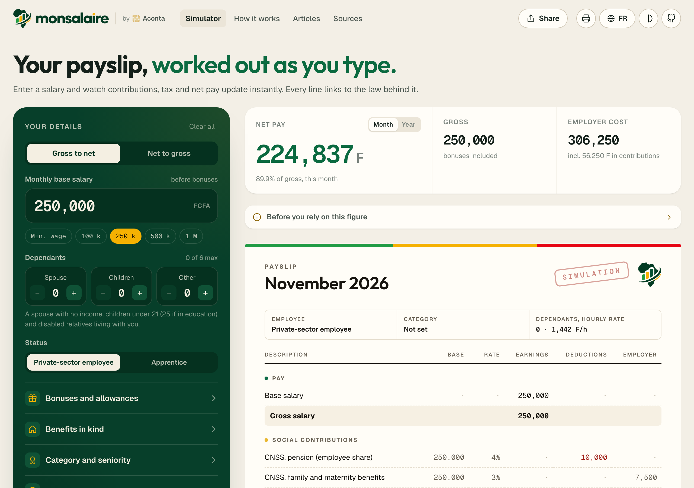
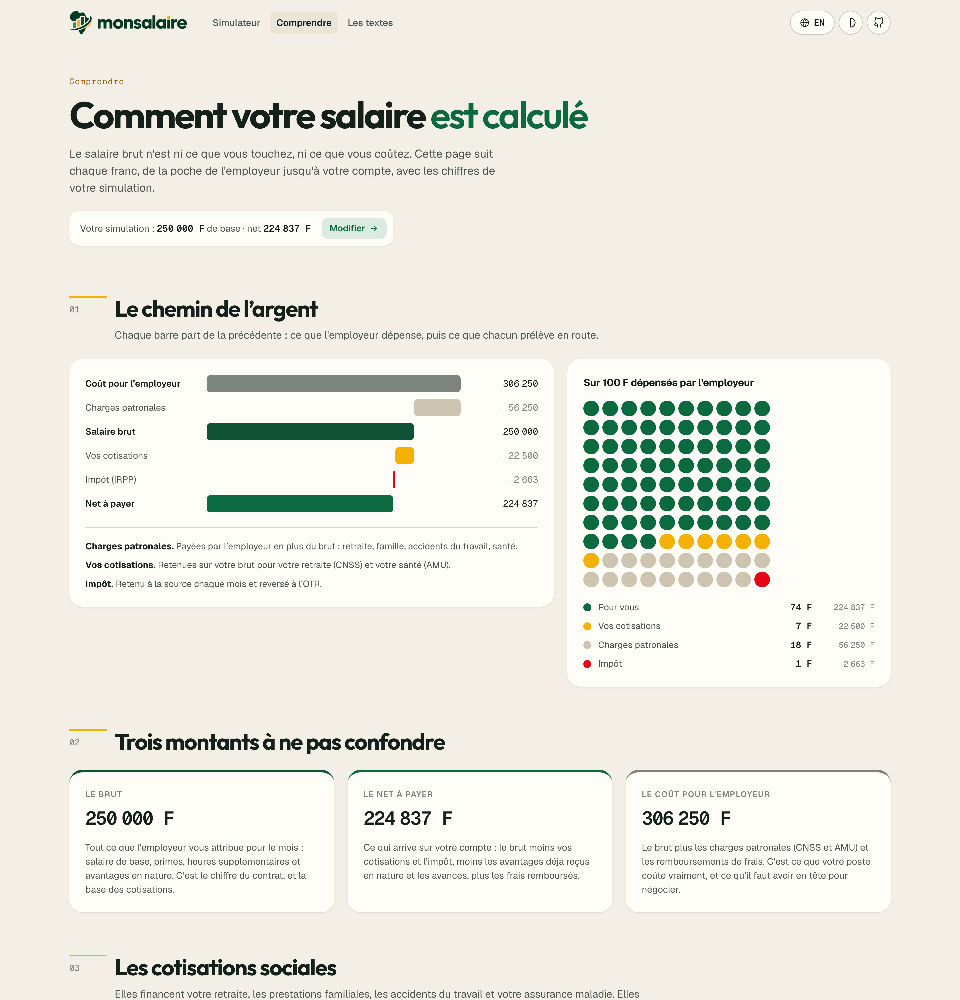
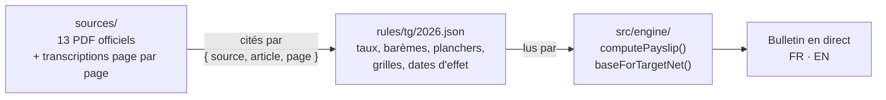

<p align="center">
  <picture>
    <source media="(prefers-color-scheme: dark)" srcset="public/brand/lockup-dark.png">
    
  </picture>
</p>

<p align="center"><b>Les salaires en perspective.</b> Votre bulletin de paie au Togo, calculé sous vos yeux.</p>

<p align="center">
  <a href="README.md">English</a> · <b>Français</b>
</p>

<p align="center">
  <a href="LICENSE"></a>
  
  <a href="sources/README.md"></a>
  <a href="sources/README.md"></a>
  
</p>

<p align="center">
  <b>Tapez un salaire. Regardez le bulletin se construire.</b><br>
  Cotisations, impôt, net à payer et coût employeur se recalculent à chaque chiffre,<br>
  et chaque ligne renvoie à l'article et à la page du texte de loi d'où elle vient.
</p>

<br>

<p align="center">
  
</p>

## Pourquoi

Au Togo, la plupart des gens découvrent leur vrai salaire en recevant leur premier bulletin. Les calculateurs en
ligne, quand ils existent, donnent un chiffre sans dire d'où il vient, et appliquent souvent les taux d'un autre pays.

**monsalaire** fait l'inverse : un vrai moteur de paie, construit uniquement à partir des textes togolais, qui
tourne dans votre navigateur et montre son raisonnement. Demandez 400 000 F net, il vous donne le salaire de base à
négocier. Touchez une ligne, il vous dit pourquoi, avec l'article et la page.

## Ce qu'il fait

| | |
|---|---|
| **Bulletin en direct** | Brut, CNSS, AMU, impôt sur le revenu (IRPP), net à payer et coût employeur, recalculés à chaque frappe. |
| **Du brut au net, du net au brut** | Tapez le net voulu : le moteur trouve le salaire de base à demander, au franc près. |
| **Tout ce qu'il y a sur un vrai bulletin** | Primes et indemnités, avantages en nature, heures sup aux cinq taux, treizième mois imposé à la marge, prime d'ancienneté, primes de panier, frais de mission, avances. |
| **La convention collective de 2026** | Catégories E1 à C4 et leurs minimums, ancienneté sur le minimum de la catégorie, alerte sous le minimum. |
| **Famille et épargne** | Conjoint, enfants et autres personnes à charge (6 au plus), épargne retraite et assurance vie, exonération des apprentis. |
| **Expliqué** | Une page Comprendre : où va chaque franc, l'impôt pas à pas, les cotisations et ce qu'elles financent. |
| **Sourcé** | 13 textes officiels archivés dans le dépôt, transcrits page par page ; chaque règle cite `{ source, article, page }`. |
| **Confidentiel** | Ni compte, ni serveur, ni cookie. Les montants saisis ne quittent pas le navigateur ; seules les pages vues et leur vitesse sont comptées, de façon anonyme et sans cookie (Vercel Web Analytics et Speed Insights). Un lien partagé contient la simulation. |
| **Bilingue** | Français et anglais, site et bulletin. Thème clair ou sombre, pensé pour le téléphone, prêt à imprimer. |

<p align="center">
  
</p>

## Chaque chiffre a sa source

La loi est une donnée, pas du code. Trois couches séparées, pour qu'une nouvelle loi de finances ne touche jamais au
moteur :



Quelques règles, vérifiées le 4 novembre 2026 ([tableau complet](sources/README.md)) :

| Règle | Valeur | Texte |
|---|---|---|
| CNSS | 4 % salarié, 17,5 % employeur ; sans plafond ; jamais sous le SMIG | Décret 2012-038, art. 1 à 3 · Code de sécurité sociale, art. 12 |
| AMU | 5 % salarié, 5 % employeur | Décret 2023-096, art. 12 et 29 |
| IRPP | abattement de 28 %, 10 000 F par personne à charge et par mois, barème de 0 à 35 % | CGI 2025, art. 26, 72, 73, 74 |
| SMIG | 52 500 F par mois | Arrêté 3790 du 31 décembre 2022 |
| Heures sup | +20 %, +40 %, +65 %, +100 % ; taux horaire = (base + sursalaire) / 173,33 | Convention collective 2026, art. 36 |

Quand un texte admet deux lectures, le simulateur le dit et indique son choix. Rien n'est repris du calculateur
d'un autre pays.

## Démarrer

```bash
git clone https://github.com/GithAlchemist/monsalaire.git
cd monsalaire
npm install
npm run dev        # http://localhost:3150
npm test           # 32 tests du moteur, sur des cas calculés à partir des textes
npm run build      # site statique dans dist/, prêt pour n'importe quel hébergeur
```

Utiliser le moteur seul :

```ts
import { computePayslip, rulesFor, emptyInput } from './src/engine';

const slip = computePayslip(
  { ...emptyInput(), baseSalary: 300000, spouses: 1, children: 2 },
  rulesFor('2026-11-04'),
  'fr',
);
slip.netPay;   // 270255
slip.irpp;     // 2745
```

## Organisation

```
rules/tg/2026.json        la loi en données : chaque valeur avec sa source, son article et sa page
sources/                  la bibliothèque : originals/ (PDF), text/ (transcriptions), sources.json, tools/
src/engine/               le moteur de paie en TypeScript pur et ses tests
src/pages/                Simulateur, Comprendre, Les textes, Conditions
src/components/           paramètres, bulletin, graphiques, en-tête et pied de page
```

Le site a quatre pages, dans les deux langues : `/` et `/en` (simulateur), `/comprendre` et `/en/understand`,
`/textes` et `/en/sources`, `/conditions` et `/en/terms`.

## Feuille de route

- [x] Togo, secteur privé, régime général : CNSS, AMU, IRPP, convention collective 2026
- [x] Bibliothèque juridique : 13 textes officiels, transcrits page par page
- [x] Français et anglais
- [ ] Agents publics (CRT, INAM), indépendants et économie informelle
- [ ] Indemnités de fin de contrat (retraite, licenciement)
- [ ] **D'autres pays** : Bénin, Sénégal, Côte d'Ivoire, Burkina Faso, Ghana
- [ ] **Comparer les pays** : le même revenu, net d'impôt, corrigé du coût de la vie (parité de pouvoir d'achat)

## Contribuer

La contribution la plus précieuse est une correction appuyée sur un texte. Un taux a changé, une règle est fausse,
un cas manque ? [Signalez une règle](https://github.com/GithAlchemist/monsalaire/issues/new?template=rule-error.yml)
avec le texte (lien, article, date). Les règles sont des données : la plupart des corrections tiennent en une
modification du JSON et un test.

Lisez [CONTRIBUTING.md](CONTRIBUTING.md) pour installer le projet, ajouter un pays ou mettre à jour les règles d'une
nouvelle année.

## Avertissement

monsalaire donne une simulation indicative pour un salarié du secteur privé au régime général. Elle ne remplace ni
le bulletin de votre employeur, ni l'avis d'un professionnel.

## Licence

[MIT](LICENSE). Les textes de loi archivés sont des documents publics de la République togolaise.

<p align="center"><sub>Pour tous ceux qui se sont un jour demandé où passait leur salaire.</sub></p>
