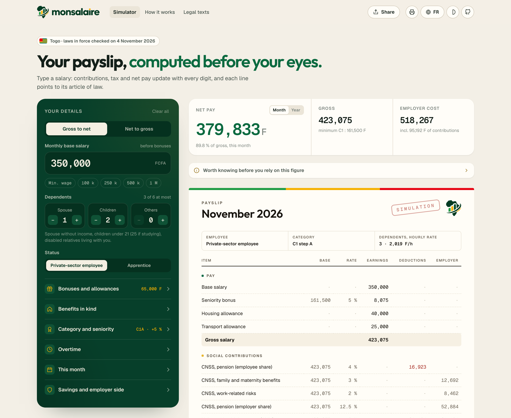
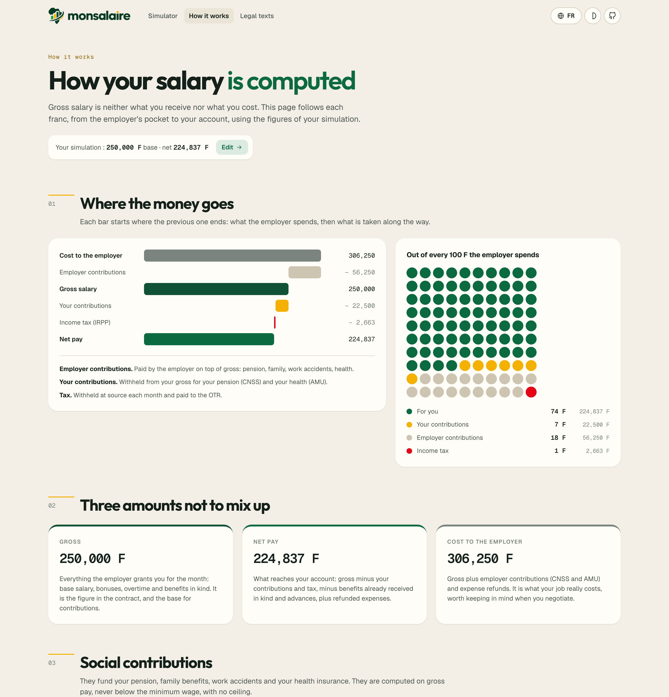
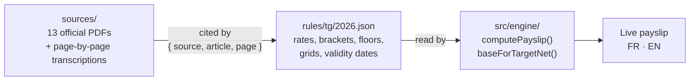

<p align="center">
  <picture>
    <source media="(prefers-color-scheme: dark)" srcset="public/brand/lockup-dark.png">
    
  </picture>
</p>

<p align="center"><b>Salaries in perspective.</b> Your payslip in Togo, computed before your eyes.</p>

<p align="center">
  <b>English</b> · <a href="README.fr.md">Français</a>
</p>

<p align="center">
  <a href="LICENSE"></a>
  
  <a href="sources/README.md"></a>
  <a href="sources/README.md"></a>
  
</p>

<p align="center">
  <b>Type a salary. Watch the payslip build itself.</b><br>
  Contributions, income tax, net pay and employer cost update with every digit,<br>
  and every single line links to the article and page of the law it comes from.
</p>

<br>

<p align="center">
  
</p>

## Why

In Togo, most people learn what their salary really is when the first payslip arrives. Online calculators, when
they exist, show a number without saying where it comes from, and often apply rates from another country.

**monsalaire** does the opposite: it is a full payroll engine built only from Togolese texts, it runs in your
browser, and it shows its work. Ask for 400 000 F net, and it tells you the base salary to negotiate. Tap any line,
and it tells you why, with the article and the page.

## What it does

| | |
|---|---|
| **Live payslip** | Gross, CNSS, AMU, income tax (IRPP), net pay and employer cost, recomputed at every keystroke. |
| **Gross to net, net to gross** | Type the net you want: the engine finds the base salary to ask for, to the franc. |
| **Everything on a real payslip** | Bonuses and allowances, benefits in kind, overtime at the five legal rates, 13th month taxed at the margin, seniority bonus, meal and mission allowances, advances. |
| **The 2026 collective agreement** | Categories E1 to C4 with their minimum wages, seniority on the category minimum, warnings below the minimum. |
| **Family and savings** | Spouse, children and other dependents (6 at most), voluntary pension and life insurance deductions, apprentice exemption. |
| **Explained** | A How it works page: where each franc goes, the tax step by step, contributions and what they pay for. |
| **Sourced** | 13 official texts archived in the repo with page-by-page transcriptions; every rule cites `{ source, article, page }`. |
| **Private by design** | No account, no server, no cookie, no tracker. Shareable links carry the simulation in the URL. |
| **Bilingual** | French and English, site and payslip alike. Light and dark themes, phone first, print-ready. |

<p align="center">
  
</p>

## Every number has a source

The law is data, not code. Three layers, kept apart so that a new finance law never touches the engine:



A few of the rules, as checked on 4 November 2026 ([full table](sources/README.md)):

| Rule | Value | Where it comes from |
|---|---|---|
| CNSS | 4 % employee, 17.5 % employer; no ceiling; never below the minimum wage | Decree 2012-038, art. 1 to 3 · Social Security Code, art. 12 |
| AMU (health) | 5 % employee, 5 % employer | Decree 2023-096, art. 12 and 29 |
| Income tax | 28 % flat deduction, 10 000 F per dependent a month, scale 0 to 35 % | Tax code 2025, art. 26, 72, 73, 74 |
| Minimum wage | 52 500 F a month | Order 3790 of 31 December 2022 |
| Overtime | +20 %, +40 %, +65 %, +100 %; hourly rate = (base + additional salary) / 173.33 | Collective agreement 2026, art. 36 |

Where a text can be read two ways, the simulator says so and states its choice. Nothing is taken from a
calculator of another country.

## Quick start

```bash
git clone https://github.com/GithAlchemist/monsalaire.git
cd monsalaire
npm install
npm run dev        # http://localhost:5173
npm test           # 32 engine tests, checked against cases worked out from the law
npm run build      # static site in dist/, ready for any host
```

Use the engine on its own:

```ts
import { computePayslip, rulesFor, emptyInput } from './src/engine';

const slip = computePayslip(
  { ...emptyInput(), baseSalary: 300000, spouses: 1, children: 2 },
  rulesFor('2026-11-04'),
  'en',
);
slip.netPay;   // 270255
slip.irpp;     // 2745
```

## Project structure

```
rules/tg/2026.json        the law as data: every value with its source, article and page
sources/                  the legal library: originals/ (PDF), text/ (transcriptions), sources.json, tools/
src/engine/               pure TypeScript payroll engine and its tests
src/pages/                Simulator, How it works, Legal texts, Terms
src/components/           controls, payslip, charts, header and footer
```

The site has four pages, in both languages: `/` and `/en` (simulator), `/comprendre` and `/en/understand`,
`/textes` and `/en/sources`, `/conditions` and `/en/terms`.

## Roadmap

- [x] Togo, private sector, general regime: CNSS, AMU, IRPP, collective agreement 2026
- [x] Legal library: 13 official texts, transcribed page by page
- [x] French and English
- [ ] Public servants (CRT pension, INAM health), self-employed and informal workers
- [ ] End-of-contract payments (retirement and dismissal indemnities)
- [ ] **Other countries**: Benin, Senegal, Côte d'Ivoire, Burkina Faso, Ghana
- [ ] **Compare countries**: the same income, net of tax, corrected for the cost of living (purchasing power parity)

## Contributing

The most valuable contribution is a correction backed by a text. Found a rate that changed, a rule that is wrong,
a case not covered? [Report a rule](https://github.com/GithAlchemist/monsalaire/issues/new?template=rule-error.yml)
with the legal text (link, article, date). Rules are data: most fixes are a JSON change and a test.

Read [CONTRIBUTING.md](CONTRIBUTING.md) to set up the project, add a country or update the rules for a new year.

## Disclaimer

monsalaire gives an indicative simulation for private-sector employees under the general regime. It replaces
neither your employer's payslip nor professional advice.

## Licence

[MIT](LICENSE). The archived legal texts are public documents of the Togolese Republic.

<p align="center"><sub>For everyone who has ever wondered where their salary went.</sub></p>
